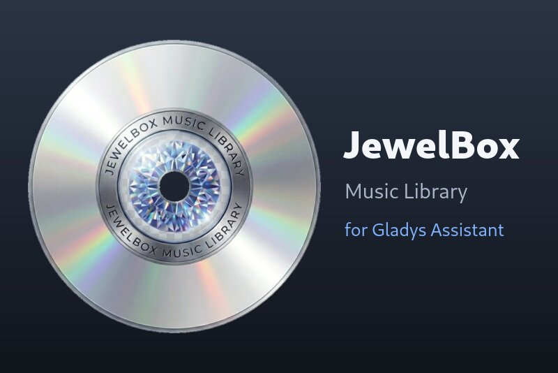
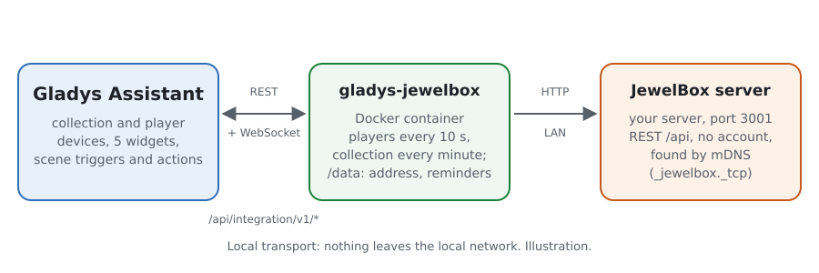
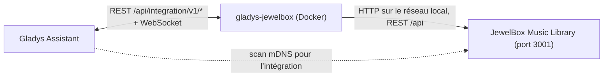
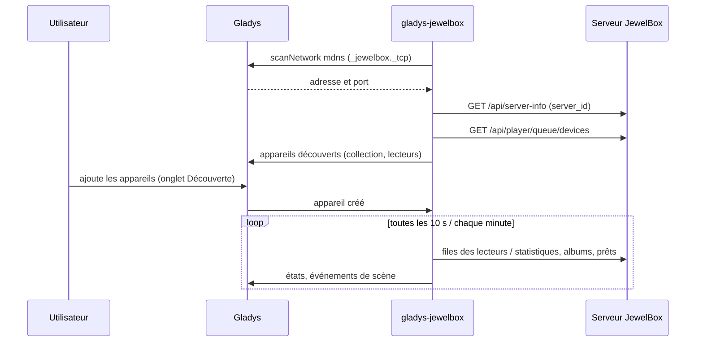
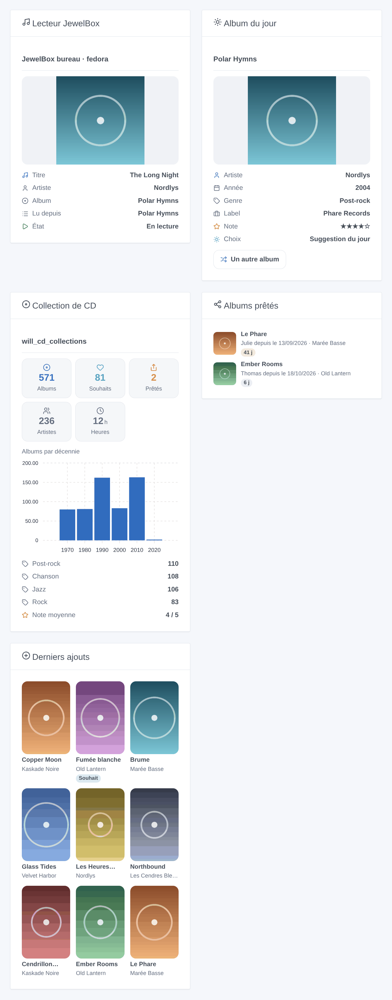
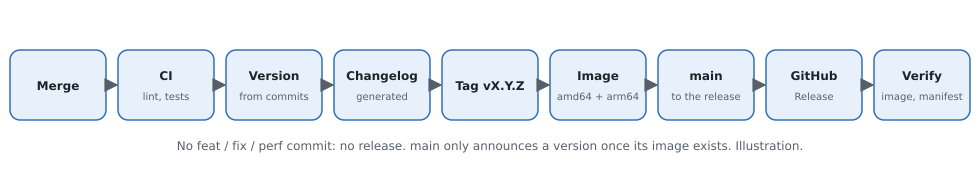

# Gladys JewelBox

[English](README.md) | **Français**

[](LICENSE)
[](https://github.com/William-De71/gladys-jewelbox/releases)
[](https://github.com/William-De71/gladys-jewelbox/actions/workflows/release.yml)
[](https://gladysassistant.com)



Votre collection de CD [JewelBox Music Library](https://github.com/William-De71/Jewelbox-Music-Library) dans Gladys Assistant : les compteurs de l’étagère, les prêts, ce que jouent les lecteurs JewelBox, des widgets et des scènes. Tout reste sur le réseau local : le serveur est trouvé par mDNS.

> **Une intégration personnelle.** Elle n’est pas dans le store de Gladys (le dépôt ne porte pas le topic `gladys-assistant-integration`, volontairement). Installez-la depuis l’URL de ce dépôt.

## Fonctionnalités

- **Appareil Collection** : albums, liste de souhaits, albums prêtés, artistes, note moyenne, heures de musique, jours du plus ancien prêt (historique et graphiques de Gladys).
- **Un appareil par lecteur JewelBox** (appli web, lecteur de bureau, appli Android) : en lecture ou non, et le « en cours de lecture » des lecteurs de musique de Gladys 5.3.0 (titre, artiste, album, pochette, durée, position). Avec JewelBox 1.18+, **piloté depuis Gladys** : lecture / pause, suivant / précédent, déplacement, volume, muet, aléatoire, répétition, et le catalogue JewelBox dans la boîte musique (parcourir, chercher, file d’attente, lancer).
- **Déclencheurs de scène** : album ajouté (collection ou liste de souhaits, ou souhait exaucé), album prêté, album rendu, prêt en retard, lecture démarrée / arrêtée, nouveau titre.
- **Actions de scène** : titre en cours, album au hasard (par genre), album du jour, prêter un album, le marquer rendu, scanner la bibliothèque musicale.
- **Cinq widgets** : lecteur avec sa pochette, collection, albums prêtés, album du jour, derniers ajouts.
- **Trouvé tout seul** sur le réseau (mDNS `_jewelbox._tcp`), avec une adresse à saisir en repli.

## Fonctionnement







### Transport

`local` uniquement. Rien ne sort du réseau local, et JewelBox ne demande aucun compte. Le cœur de Gladys fait le scan mDNS (les conteneurs d’intégration ne voient pas le multicast), puis l’intégration parle à JewelBox en HTTP simple.

### Un lecteur joue-t-il ?

JewelBox n’enregistre pas d’état lecture / pause : chaque lecteur sauvegarde sa file sur le serveur, avec la position, toutes les 10 s (appli web) ou 30 s (bureau et Android), et une fois de plus à la pause. L’intégration déduit l’état de ces écritures : un nouveau titre ou une position qui avance au rythme habituel signifie « en lecture », une écriture anticipée ou aucune écriture pendant le rythme + 20 s signifie « à l’arrêt ». Une pause est donc vue avec 10 à 50 s de retard. C’est le repli de JewelBox 1.17 et des lecteurs plus anciens.

### Contrôle à distance (JewelBox 1.18+)

JewelBox 1.18 relaie des ordres vers ses lecteurs : chaque lecteur dont le réglage **Autoriser le contrôle à distance** est actif (c’est le cas par défaut) garde un flux d’événements ouvert vers le serveur, et chaque lecteur signale son état en direct (lecture / pause, titre, position, volume, modes) à chaque changement. L’intégration lit cet état à chaque tour au lieu de le déduire, suit les changements au fil de l’eau sur `GET /api/player/remote/watch` (un tour dans la seconde), et transforme une écriture sur une fonctionnalité du lecteur en ordre (`POST /api/player/remote/devices/:id/commands`). Les capacités annoncées par un lecteur sont mémorisées dans `/data/players.json` : ses fonctionnalités ne vont et ne viennent pas quand il est fermé.

La boîte musique du tableau de bord lit le catalogue à la demande : la racine propose Albums (de A à Z par artiste), Playlists et Listes intelligentes ; un album liste ses titres et sa radio ; la recherche trouve des artistes (joués en radio), des albums et des titres. Lire, lire ensuite et ajouter à la file sont relayés au lecteur, qui les lance comme ses propres boutons.

### En cours de lecture

Un lecteur publie aussi les fonctionnalités `music` de Gladys 5.3.0 : titre, artiste, album, pochette, durée et position. Elles ne changent que sur un événement (nouveau titre, pause, déplacement dans le titre), jamais sur une minuterie : la position est un relevé que Gladys extrapole tant que le lecteur joue. La pochette est servie par l’intégration derrière une clé (le navigateur ne contacte jamais le serveur JewelBox), 300 Ko au plus. Le widget « appareils de la pièce » les affiche ; la boîte musique du tableau de bord propose les lecteurs qui acceptent le contrôle à distance.

## Appareils et fonctionnalités

| Appareil            | Fonctionnalité                              | Catégorie / type                           | Notes                            |
| ------------------- | ------------------------------------------- | ------------------------------------------ | -------------------------------- |
| Collection JewelBox | Albums, Liste de souhaits, Prêtés, Artistes | `counter-sensor` / `integer`               | d’après `/api/stats`             |
| Collection JewelBox | Note moyenne                                | `counter-sensor` / `decimal`               | de 1 à 5                         |
| Collection JewelBox | Durée d’écoute                              | `duration` / `decimal`, heures             | toute la collection              |
| Collection JewelBox | Plus ancien prêt                            | `duration` / `integer`, jours              | 0 sans prêt                      |
| Lecteur JewelBox    | Lecture                                     | `music` / `playback_state`                 | écrivable avec le contrôle       |
| Lecteur JewelBox    | Titre, Artiste, Album                       | `text` / `text`                            | le titre en cours                |
| Lecteur JewelBox    | En cours : titre, artiste, album            | `music` / `title`, `artist`, `album`       | vides sans file                  |
| Lecteur JewelBox    | En cours : pochette                         | `music` / `artwork`                        | une clé d’image                  |
| Lecteur JewelBox    | Durée du titre, Position dans le titre      | `music` / `duration`, `position`, secondes | position sur événement seulement |
| Lecteur JewelBox    | Titre suivant, Titre précédent              | `music` / `next`, `previous`               | avec le contrôle                 |
| Lecteur JewelBox    | Volume, Muet, Aléatoire, Répétition         | `music` / `volume`, `mute`, …              | selon les capacités du lecteur   |

Les identifiants externes reposent sur ce que JewelBox conserve : le `server_id` du serveur et l’identifiant de chaque lecteur, jamais une adresse ni un libellé.

Les fonctionnalités `music` sont arrivées dans une version ultérieure : un lecteur créé avant les reçoit avec le bouton **Mettre à jour** de l’onglet Découverte ; ses autres fonctionnalités, ses scènes et ses widgets ne changent pas.

## Déclencheurs, actions de scène et widgets



_Illustration générée, pas une capture d’écran : albums inventés et pochettes neutres, dessinés par `docs/illustrations/render.sh` avec le vrai code des widgets._

| Déclencheur                                               | Quand                                                                         | Variables                                              |
| --------------------------------------------------------- | ----------------------------------------------------------------------------- | ------------------------------------------------------ |
| `album_added`                                             | un album dans la collection ou la liste de souhaits, un album souhaité acheté | title, artist, year, genre, label, list, from_wishlist |
| `album_lent` / `album_returned`                           | un prêt commence / se termine (pas quand une scène l’a fait)                  | title, artist, borrower, days                          |
| `loan_overdue`                                            | un prêt dépasse le délai de rappel, une fois par prêt                         | title, artist, borrower, days                          |
| `playback_started` / `playback_stopped` / `track_changed` | un lecteur démarre, s’arrête, change de titre                                 | player, title, artist, album                           |

| Action                        | Fait                                                                                             | Sorties                                                   |
| ----------------------------- | ------------------------------------------------------------------------------------------------ | --------------------------------------------------------- |
| `get_now_playing`             | lit un lecteur                                                                                   | player_name, playing, title, artist, album                |
| `sleep_timer`                 | met un lecteur en pause après 15 à 90 min (fondu) ou en fin de piste, ou annule (JewelBox 1.20+) | player_name                                               |
| `random_album`                | tire un album (genre facultatif)                                                                 | title, artist, year, genre, label, summary                |
| `album_of_the_day`            | la première suggestion du jour de JewelBox                                                       | idem                                                      |
| `lend_album` / `return_album` | prête un album (numéro ou titre exact) / le marque rendu                                         | title, artist, borrower (, days)                          |
| `scan_library`                | scanne le dossier de musique, attend la fin                                                      | finished, matched_albums, matched_tracks, unmatched_files |

Exemples :

- **Quand un album est prêté** → m’envoyer « {{triggerEvent.data.title}} prêté à {{triggerEvent.data.borrower}} ».
- **Quand un prêt est en retard** → me rappeler qui a {{triggerEvent.data.title}} depuis {{triggerEvent.data.days}} jours.
- **Quand le lecteur du salon démarre** → tamiser les lumières ; **chaque dimanche à 10 h** → « Album du jour » → envoyer son résumé.

## Prérequis

- Gladys Assistant **5.3.0** ou plus récent (lecteurs de musique). Les instances plus anciennes ne peuvent pas installer l’intégration.
- JewelBox Music Library 1.17.0 ou plus récent sur le même réseau local.
- Pour la découverte mDNS : JewelBox annonce `_jewelbox._tcp` (actif par défaut). En Docker, utilisez `network_mode: host`, sinon saisissez son adresse.

## Installation

1. Dans Gladys : **Intégrations → Intégrations externes → installer depuis l’URL d’un dépôt**, puis `https://github.com/William-De71/gladys-jewelbox`.
2. Mode développeur : construisez l’image sur la machine de Gladys (`docker build -t gladys-jewelbox .`) et installez-la depuis « Mode développeur : installer depuis une image Docker ».

## Configuration

| Champ                     | Par défaut | Rôle                                                               |
| ------------------------- | ---------- | ------------------------------------------------------------------ |
| Adresse du serveur        | vide       | vide : trouvé par mDNS ; sinon `http://hôte:3001`                  |
| Langue des textes         | Français   | noms d’appareils, états, textes des actions                        |
| Rappel de prêt (jours)    | 30         | délai de `loan_overdue` et du badge orange                         |
| Lecteurs proposés (jours) | 90         | l’onglet Découverte ne propose que les lecteurs utilisés récemment |

Le bouton **Tester la connexion** cherche le serveur et dit ce qu’il voit.

## Utilisation

1. Enregistrez la configuration, puis **Tester la connexion**.
2. Onglet **Découverte** : ajoutez l’appareil Collection et les lecteurs que vous utilisez.
3. Ajoutez les widgets sur un tableau de bord, écrivez des scènes avec les déclencheurs et actions ci-dessus.

## Développement

```bash
npm install
npm test                      # node --test, le faux serveur JewelBox, jamais le réseau
npm run lint && npm run format:check
docs/illustrations/render.sh  # les images des widgets
scripts/build-cover.sh        # cover.jpg depuis l’icône de JewelBox
```

Contre un vrai Gladys : installez en mode développeur pour obtenir un jeton, puis `GLADYS_HOST_API_URL=http://localhost:1443 GLADYS_INTEGRATION_TOKEN=… GLADYS_INTEGRATION_SELECTOR=… npm start`. `JEWELBOX_DATA_DIR` déplace `/data`.

## Publication



Chaque fusion sur `main` publie une version quand ses Conventional Commits le justifient (`feat` → mineure, `fix` → corrective, sous 1.0.0 un changement cassant donne une mineure) : CI, version, `CHANGELOG.md` généré, tag, image multi-arch `ghcr.io/william-de71/gladys-jewelbox`, puis `main`, la GitHub Release, et une vérification que l’image est publique et que le topic du store est absent. Les titres de PR sont les lignes du changelog. Le ruleset de `main` interdit seulement la suppression et le force-push : une règle « PR obligatoire » bloquerait le commit de release (autoriser GitHub Actions à la contourner, ou passer par une GitHub App).

## Dépannage

- **« Aucun serveur JewelBox trouvé »** : JewelBox arrêté, mDNS désactivé (`MDNS_ENABLED=false`) ou JewelBox derrière un pont Docker : saisissez son adresse.
- **Un lecteur est « à l’arrêt » alors qu’il joue** : il n’a pas enregistré de position depuis un moment (un onglet en arrière-plan peut ralentir) ; il revient à l’écriture suivante.
- **Pas de pochette dans un widget** : la pochette n’est pas stockée sur le serveur (une URL distante), ou elle pèse plus de 300 Ko.
- Journaux : Paramètres → Supervision ; `DEBUG=gladys-integration-sdk` pour le SDK en mode développeur.

## Sécurité

Voir [SECURITY.md](SECURITY.md). JewelBox n’a pas d’authentification : n’importe qui sur le réseau local peut le lire et le modifier, Gladys compris.

## Licence

[Apache-2.0](LICENSE). Voir [NOTICE](NOTICE).
