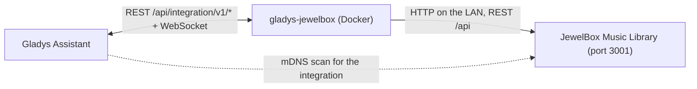
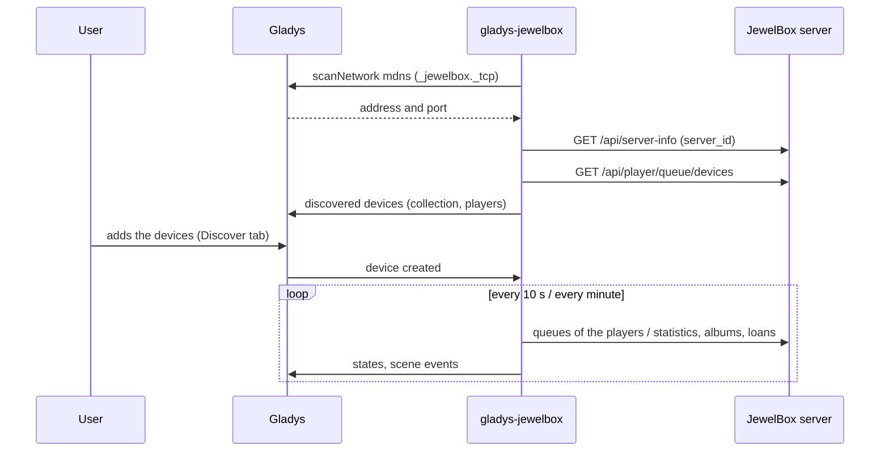
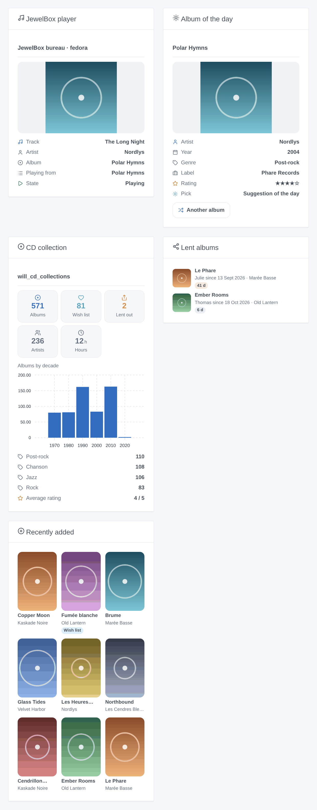

# Gladys JewelBox

**English** | [Français](README.fr.md)

[](LICENSE)
[](https://github.com/William-De71/gladys-jewelbox/releases)
[](https://github.com/William-De71/gladys-jewelbox/actions/workflows/release.yml)
[](https://gladysassistant.com)


Your [JewelBox Music Library](https://github.com/William-De71/Jewelbox-Music-Library) CD collection in Gladys Assistant: the counters of the shelf, the loans, what the JewelBox players play, dashboard widgets and scenes. Everything stays on the local network: the server is found by mDNS.

> **A personal integration.** It is not in the Gladys store (the repository does not carry the `gladys-assistant-integration` topic, on purpose). Install it from the URL of this repository.

## Features

- **Collection device**: albums, wish list, albums lent out, artists, average rating, hours of music, days of the oldest loan (history and charts of Gladys).
- **One device per JewelBox player** (web app, desktop player, Android app): playing or not, and the now playing of the music players of Gladys 5.3.0 (title, artist, album, cover, duration, position). With JewelBox 1.18+, **controlled from Gladys**: play / pause, next / previous, seek, volume, mute, shuffle, repeat, and the JewelBox catalog in the music box (browse, search, queue, play).
- **Scene triggers**: album added (collection or wish list, or a wish come true), album lent, album returned, loan overdue, playback started / stopped, new track.
- **Scene actions**: what is playing, a random album (by genre), the album of the day, lend an album, mark it returned, scan the music library.
- **Five dashboard widgets**: player with its cover, collection, lent albums, album of the day, recently added.
- **Found by itself** on the network (mDNS `_jewelbox._tcp`), an address to type as a fallback.

## How it works






### Transport

`local` only. Nothing leaves the local network, and JewelBox needs no account. The core of Gladys makes the mDNS scan (the containers of integrations cannot see multicast), then the integration talks to JewelBox in plain HTTP.

### Is a player playing?

JewelBox does not store a play / pause state: each player saves its queue on the server, with the position, every 10 s (web app) or 30 s (desktop and Android), and once more at a pause. The integration deduces the state from these writes: a new track or a position moving at the usual pace is “playing”, an early write or no write for the pace + 20 s is “stopped”. A pause is therefore seen 10 to 50 s late. That is the fallback of JewelBox 1.17 and older players.

### Remote control (JewelBox 1.18+)

JewelBox 1.18 relays commands to its players: each player whose **Allow remote control** setting is on (the default) keeps an event stream open to the server, and every player reports its live state (play / pause, track, position, volume, modes) at each change. The integration reads that state at each round instead of deducing it, follows the changes as they happen on `GET /api/player/remote/watch` (a round within a second), and turns a write on a player feature into a command (`POST /api/player/remote/devices/:id/commands`). The capabilities a player announced are remembered in `/data/players.json`, so its features do not come and go when it is closed.

The music box of the dashboard reads the catalog on demand: the root offers Albums (A–Z by artist), Playlists and Smart playlists; an album lists its tracks and its radio; the search finds artists (played as their radio), albums and tracks. Play, play next and add to queue are relayed to the player, which starts them like its own buttons do.

### Now playing

A player also publishes the `music` features of Gladys 5.3.0: title, artist, album, cover, duration and position. They change only on an event (a new track, a pause, a seek), never on a timer: the position is a sample that Gladys extrapolates while the player plays. The cover is served by the integration behind a key (the browser never loads the JewelBox server), at most 300 KB. The “devices in the room” widget shows them; the music box of the dashboard offers the players that accept remote control.

## Devices and features

| Device              | Feature                               | Category / type                           | Notes                   |
| ------------------- | ------------------------------------- | ----------------------------------------- | ----------------------- |
| JewelBox collection | Albums, Wish list, Lent out, Artists  | `counter-sensor` / `integer`              | from `/api/stats`       |
| JewelBox collection | Average rating                        | `counter-sensor` / `decimal`              | 1 to 5                  |
| JewelBox collection | Playing time                          | `duration` / `decimal`, hours             | whole collection        |
| JewelBox collection | Oldest loan                           | `duration` / `integer`, days              | 0 without loan          |
| JewelBox player     | Playback                              | `music` / `playback_state`                | writable with control   |
| JewelBox player     | Track, Artist, Album                  | `text` / `text`                           | the current track       |
| JewelBox player     | Now playing: title, artist, album     | `music` / `title`, `artist`, `album`      | empty when no queue     |
| JewelBox player     | Now playing: cover                    | `music` / `artwork`                       | an image key            |
| JewelBox player     | Track duration, Position in the track | `music` / `duration`, `position`, seconds | position on events only |
| JewelBox player     | Next track, Previous track            | `music` / `next`, `previous`              | with control            |
| JewelBox player     | Volume, Mute, Shuffle, Repeat         | `music` / `volume`, `mute`, …             | per player capability   |

External ids are built on the identifiers JewelBox keeps: the `server_id` of the server and the device id of each player, never an address or a label.

The `music` features were added in a later version: a player created before gets them with the **Update** button of the Discover tab; its other features, scenes and widgets are unchanged.

## Scene triggers, actions and widgets



_Generated illustration, not a screenshot: invented albums and plain covers, drawn by `docs/illustrations/render.sh` with the real code of the widgets._

| Trigger                                                   | When                                                               | Variables                                              |
| --------------------------------------------------------- | ------------------------------------------------------------------ | ------------------------------------------------------ |
| `album_added`                                             | an album in the collection or the wish list, a wished album bought | title, artist, year, genre, label, list, from_wishlist |
| `album_lent` / `album_returned`                           | a loan starts / ends (not when a scene did it)                     | title, artist, borrower, days                          |
| `loan_overdue`                                            | a loan passes the reminder delay, once per loan                    | title, artist, borrower, days                          |
| `playback_started` / `playback_stopped` / `track_changed` | a player starts, stops, changes track                              | player, title, artist, album                           |

| Action                        | Does                                                   | Outputs                                                   |
| ----------------------------- | ------------------------------------------------------ | --------------------------------------------------------- |
| `get_now_playing`             | reads a player                                         | player_name, playing, title, artist, album                |
| `random_album`                | draws an album (optional genre)                        | title, artist, year, genre, label, summary                |
| `album_of_the_day`            | the first suggestion of the day of JewelBox            | same                                                      |
| `lend_album` / `return_album` | lends an album (id or exact title) / marks it returned | title, artist, borrower (, days)                          |
| `scan_library`                | scans the music folder, waits for the end              | finished, matched_albums, matched_tracks, unmatched_files |

Examples:

- **When an album is lent** → send me “{{triggerEvent.data.title}} lent to {{triggerEvent.data.borrower}}”.
- **When a loan is overdue** → remind me who has {{triggerEvent.data.title}} for {{triggerEvent.data.days}} days.
- **When the living room player starts** → dim the lights; **every Sunday at 10:00** → “Album of the day” → send its summary.

## Prerequisites

- Gladys Assistant **5.3.0** or later (music players). Older instances cannot install the integration.
- JewelBox Music Library 1.17.0 or later on the same local network.
- For the mDNS discovery: JewelBox announces `_jewelbox._tcp` (on by default). In Docker, use `network_mode: host`, otherwise type its address.

## Installation

1. In Gladys: **Integrations → External integrations → install from a repository URL**, then `https://github.com/William-De71/gladys-jewelbox`.
2. Developer mode: build the image on the Gladys machine (`docker build -t gladys-jewelbox .`) and install it from “Developer mode: install from a Docker image”.

## Configuration

| Field                 | Default | Role                                                 |
| --------------------- | ------- | ---------------------------------------------------- |
| Server address        | empty   | empty: found by mDNS; else `http://host:3001`        |
| Language of the texts | French  | names of devices, statuses, texts of the actions     |
| Loan reminder (days)  | 30      | delay of `loan_overdue` and of the orange badge      |
| Players shown (days)  | 90      | the Discover tab only offers the players used lately |

The **Test the connection** button finds the server and says what it sees.

## Usage

1. Save the configuration, then **Test the connection**.
2. **Discover** tab: add the collection device and the players you use.
3. Add the widgets on a dashboard, write scenes with the triggers and actions above.

## Development

```bash
npm install
npm test                      # node --test, the fake JewelBox server, never the network
npm run lint && npm run format:check
docs/illustrations/render.sh  # the widget images
scripts/build-cover.sh        # cover.jpg from the JewelBox icon
```

Run against a real Gladys: install in developer mode to get a token, then `GLADYS_HOST_API_URL=http://localhost:1443 GLADYS_INTEGRATION_TOKEN=… GLADYS_INTEGRATION_SELECTOR=… npm start`. `JEWELBOX_DATA_DIR` moves `/data`.

## Release


Every merge on `main` releases when its Conventional Commits deserve it (`feat` → minor, `fix` → patch, below 1.0.0 a breaking change is a minor): CI, version, `CHANGELOG.md` generated, tag, multi-arch image `ghcr.io/william-de71/gladys-jewelbox`, then `main`, the GitHub Release, and a check that the image is public and that the store topic is absent. PR titles are the changelog lines. The ruleset of `main` forbids deletion and force-push only: a “PR required” rule would block the release commit (allow GitHub Actions to bypass it, or use a GitHub App).

## Troubleshooting

- **“No JewelBox server found”**: JewelBox stopped, mDNS off (`MDNS_ENABLED=false`) or JewelBox in a Docker bridge: type its address.
- **A player is “stopped” while it plays**: it saved no position for a while (a browser tab in the background may slow down); it comes back at the next write.
- **No cover in a widget**: the cover is not stored on the server (a remote URL), or it weighs over 300 KB.
- Logs: Settings → Supervision; `DEBUG=gladys-integration-sdk` for the SDK in developer mode.

## Security

See [SECURITY.md](SECURITY.md). JewelBox has no authentication: anyone on the local network can read and change it, Gladys included.

## License

[Apache-2.0](LICENSE). See [NOTICE](NOTICE).
